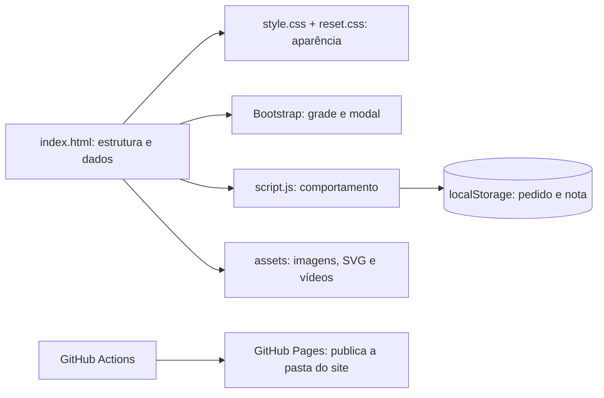

# Guia do código — Recanto do Picuí

Este guia acompanha a versão do site dos PRs #7 e #9, já mesclados na `main`. Abra no VS Code a pasta `restaurante-recanto-do-picui` e use os números de linha indicados. Linhas vazias apenas separam assuntos; os comentários e fechamentos repetidos são explicados junto dos blocos que encerram. Os arquivos minificados do Bootstrap e os vídeos são de terceiros/binários; explico a interface deles com o projeto, não cada byte interno.

## 1. O projeto em uma imagem mental

O navegador lê o HTML, baixa CSS/JS/imagens/vídeo, constrói o DOM e executa `script.js` depois de analisar o documento (`defer`). O JavaScript lê os pratos do próprio HTML, guarda IDs no `localStorage` e redesenha a lista do pedido. O Pages apenas hospeda os arquivos estáticos; não há servidor de pedidos, pagamento ou banco de dados remoto.

### Vocabulário para acompanhar

| Termo | Significado no projeto |
| --- | --- |
| `id="pedido"` | Identificador único. `href="#pedido"` rola para esse elemento; `querySelector('#pedido')` o encontra. |
| `class="card-prato"` | Classe reutilizável para aplicar CSS e encontrar vários cards. |
| `data-prato` / `data-preco` | Dados personalizados do HTML, lidos em JS com `dataset.prato` / `dataset.preco`. |
| DOM | Árvore de elementos que o navegador cria a partir do HTML. |
| Evento | Algo que ocorreu, como `click`, `submit`, `change` ou `keydown`. |
| `localStorage` | Pequeno armazenamento do navegador, separado por origem. Só guarda texto. |
| `aria-*` | Informações adicionais para tecnologias assistivas; não substituem HTML semântico. |
| `defer` | Baixa o script sem bloquear o HTML e o executa após a análise da página, na ordem dos scripts. |

## 2. `restaurante-recanto-do-picui/index.html`, linha por linha

### Documento e arquivos carregados

| Linha | O que faz |
| --- | --- |
| 1 | Declara HTML5. Evita que o navegador use um modo antigo de compatibilidade. |
| 2 | Abre o documento e informa que seu idioma principal é português do Brasil. |
| 3 | Abre o `head`, onde ficam metadados e referências aos arquivos. |
| 4 | Usa UTF-8 para acentos como “Picuí” aparecerem corretamente. |
| 5 | Faz a largura da página acompanhar a tela do celular. |
| 6 | Descreve o conteúdo para mecanismos de busca e prévias. |
| 7 | Define o texto exibido na aba do navegador. |
| 8 | Usa o pequeno ícone SVG da pasta `assets` como favicon. |
| 9 | Carrega o CSS do Bootstrap. Ele oferece `row`, `col-*` e estilos do modal. |
| 10 | Carrega o reset CSS, que normaliza margens, espaçamentos e tamanho das caixas. |
| 11 | Carrega o CSS próprio **por último**; regras equivalentes nele podem personalizar as do Bootstrap. |
| 12 | Carrega o bundle JS do Bootstrap, necessário ao modal. |
| 13 | Carrega o JavaScript próprio. Os dois scripts usam `defer`; por isso o Bootstrap vem antes do nosso código. |
| 14 | Fecha o `head`. |
| 15 | Abre o conteúdo visível (`body`). |

### Cabeçalho e apresentação

| Linha | O que faz |
| --- | --- |
| 16 | Comentário que registra a correção de acessibilidade do link de salto. Comentários HTML não aparecem na página. |
| 17 | Link para `#conteudo`; quem usa teclado pode saltar o menu repetido. O CSS o mostra quando recebe foco. |
| 18 | Abre o cabeçalho, cuja classe recebe estilo de barra fixa no topo. |
| 19 | A marca é um link para `#inicio`; `aria-label` fornece um nome claro para leitor de tela. |
| 20 | Comentário que explica o estado acessível do menu móvel. |
| 21 | Botão de menu: `type="button"` evita envio de formulário; `aria-controls` aponta para `#navegacao`; `aria-expanded` começa em `false`. |
| 22 | Três traços visuais do hambúrguer. `aria-hidden="true"` impede que sejam lidos como conteúdo. |
| 23 | Fecha o botão. |
| 24 | Abre a navegação e lhe dá o nome “Navegação principal”. |
| 25 | Abre a lista de links. |
| 26 | “Início” aponta para o `id="inicio"` da linha 35. |
| 27 | “Cardápio” aponta para o `id="cardapio"` da linha 41. |
| 28 | “História” aponta para o `id="historia"` da linha 96. |
| 29 | “Meu pedido” aponta para a linha 81; o `span` mostra a quantidade e será atualizado pelo JS. |
| 30 | “Contato” aponta para o `id="contato"` da linha 139. |
| 31–33 | Fecham, nessa ordem, a lista, o `nav` e o cabeçalho. |
| 34 | Abre o `main`, conteúdo principal e destino do link de salto. Deve haver um único `main`. |
| 35 | Abre a seção inicial e a relaciona ao título de linha 37 por `aria-labelledby`. |
| 36 | Pequeno texto acima do título, estilizado como sobretítulo. |
| 37 | `h1` é o título principal da página. |
| 38 | Parágrafo de apresentação. |
| 39 | Chamada para ação; é um link porque navega para outra parte da mesma página. |
| 40 | Fecha a seção inicial. |

### Cardápio e dados usados pelo JavaScript

| Linha | O que faz |
| --- | --- |
| 41 | Abre a seção Cardápio, destino de `#cardapio`, com título associado. |
| 42–46 | Contêiner do cabeçalho da seção, com sobretítulo, `h2`, descrição e fechamento. |
| 47 | `grade-pratos` é o pai usado na delegação de eventos; `row g-4` cria uma linha Bootstrap com espaçamento. |
| 48 | Primeira coluna: ocupa 12/12 em celular, 6/12 em tela média e 4/12 em tela grande. |
| 49 | Abre um `article` independente. `data-prato` é o ID estável; `data-preco="7900"` significa 7.900 centavos = R$ 79,00. Inteiros evitam erros de arredondamento. |
| 50 | Imagem do prato: caminho relativo, descrição `alt`, dimensões originais e carregamento tardio (`lazy`). |
| 51 | Agrupa o texto e os controles do card. |
| 52 | Nome do prato; o JS o lê para compor o catálogo. |
| 53 | Descrição dos acompanhamentos. |
| 54 | Comentário que registra por que a ação passou a ser botão semântico. |
| 55 | Exibe preço e botão. `type="button"` evita enviar formulários; `btn-pedir` é capturada por delegação no JS. |
| 56–58 | Fecham o conteúdo, o `article` e a coluna do primeiro prato. |
| 59 | Abre a segunda coluna com os mesmos breakpoints da primeira. |
| 60 | Segundo `article`: ID `vo-sinha`, preço 8.900 centavos. |
| 61 | Foto da Carne Vó Sinhá com texto alternativo e tamanho original. |
| 62 | Abre a área de conteúdo do segundo card. |
| 63 | Nome, também lido pelo JavaScript. |
| 64 | Descrição dos ingredientes. |
| 65 | Preço formatado para a pessoa e botão de adicionar. |
| 66–68 | Fecham conteúdo, card e coluna. |
| 69 | Abre a terceira coluna. |
| 70 | Terceiro `article`: ID `batata-frita`, preço 1.990 centavos. |
| 71 | Foto com `alt`, dimensões e `loading="lazy"`. |
| 72 | Abre a área textual. |
| 73 | Nome do prato. |
| 74 | Breve descrição. |
| 75 | Preço formatado e botão de adicionar. |
| 76–80 | Fecham conteúdo, card, coluna, grade e seção Cardápio. |

**Por que o preço aparece duas vezes?** O texto `R$ 79,00` é para leitura humana. O atributo `data-preco="7900"` é para cálculo. Se mudar um preço, atualize os dois para não criar divergência.

### Pedido

| Linha | O que faz |
| --- | --- |
| 81 | Abre a seção Pedido; o `id` recebe o link do menu. |
| 82 | Agrupa título e explicação. |
| 83 | Sobretítulo decorativo. |
| 84 | `h2` que dá nome à seção. |
| 85 | Explica que pedido e pagamento são apenas simulações locais. |
| 86 | Botão “Como funciona?”: os atributos `data-bs-*` mandam o Bootstrap abrir `#modal-ajuda`. |
| 87 | Fecha o bloco introdutório. |
| 88 | Abre o painel da lista. |
| 89 | Mensagem inicial; JS a oculta quando há itens. `tabindex="-1"` permite focá-la após remover o último item, sem incluí-la na sequência normal de Tab. |
| 90 | Lista vazia no HTML; o JS cria seus elementos `li`. |
| 91 | Total inicial; JS substitui o valor conforme o pedido. |
| 92 | Botão de limpeza começa `disabled` porque não há nada para limpar. |
| 93 | Fecha o painel. |
| 94 | Região de status para anunciar adições e remoções a leitores de tela. `sr-only` a oculta visualmente; `aria-live` anuncia mudanças. |
| 95 | Fecha a seção. |

### História, desenho vetorial e vídeo

| Linha | O que faz |
| --- | --- |
| 96–97 | Abrem a seção História e seu contêiner de largura limitada. |
| 98 | Abre o SVG. `viewBox` define coordenadas internas de 0 a 100; `role="img"` e `aria-labelledby` dão semântica e nome. |
| 99 | `<title>` fornece o nome acessível do desenho. |
| 100 | Desenha um círculo, o sol. `cx/cy` são coordenadas do centro e `r` é o raio. |
| 101 | Desenha raios com um caminho. `stroke` é a cor do traço; `round` arredonda as extremidades. |
| 102–103 | Duas elipses concêntricas fazem o prato; `fill="none"` deixa o centro transparente. |
| 104 | Fecha o SVG. SVG faz sentido aqui porque o ícone é estático e deve continuar nítido em qualquer tamanho. |
| 105 | Sobretítulo. |
| 106 | Título da seção, associado por `aria-labelledby` na linha 96. |
| 107 | Contexto para o teaser. |
| 108 | `figure` agrupa o vídeo e sua legenda/crédito. |
| 109 | Player nativo: `controls` permite pausar; `preload="metadata"` baixa só dados iniciais; `poster` é a capa; `aria-label` identifica o conteúdo. |
| 110 | Primeira fonte MP4. O navegador tenta fontes na ordem apresentada. |
| 111 | Fonte alternativa WebM para navegadores que prefiram ou suportem esse formato. |
| 112 | Texto de fallback se o navegador não reproduzir nenhum formato. |
| 113 | Fecha o player. |
| 114 | Legenda e crédito com link original; `target="_blank"` abre outra aba e `rel="noopener noreferrer"` protege a página de origem. |
| 115–117 | Fecham `figure`, contêiner e seção. |

### Avaliação e formulário

| Linha | O que faz |
| --- | --- |
| 118–119 | Abrem a seção de avaliação e o bloco central. |
| 120 | Sobretítulo. |
| 121 | Título da avaliação. |
| 122 | Explica que a nota é uma demonstração local. |
| 123 | Abre o formulário de avaliação. |
| 124–125 | `fieldset` agrupa as opções; `legend` nomeia o grupo para leitores de tela. |
| 126 | Contêiner visual das cinco estrelas. |
| 127 | Rádio de valor 1 e seu `label`. O símbolo é visual (`aria-hidden`); o texto `sr-only` anuncia “1 estrela”. `required` exige uma escolha no grupo. |
| 128 | Mesmo padrão para nota 2; o `name="nota"` igual agrupa os rádios, permitindo apenas um marcado. |
| 129 | Opção de 3 estrelas. |
| 130 | Opção de 4 estrelas. |
| 131 | Opção de 5 estrelas. |
| 132–133 | Fecham o contêiner das estrelas e o grupo de campos. |
| 134 | Botão `submit`: envia o evento ao JS, que impede envio de rede e salva a nota localmente. |
| 135 | Fecha o formulário. |
| 136 | Região de status onde o JS mostra a nota salva. |
| 137–138 | Fecham o bloco e a seção. |
| 139 | Abre a seção de contato/demonstração. |
| 140–142 | Sobretítulo, título e aviso de que a sugestão não é enviada. |
| 143 | Comentário sobre rótulos corretamente associados. |
| 144 | Abre o formulário de sugestão. |
| 145 | Campo Nome: `for="nome"` liga o rótulo ao `id="nome"`; `maxlength`, `autocomplete` e `required` orientam a entrada. |
| 146 | Campo do prato sugerido, obrigatório e limitado a 80 caracteres. |
| 147 | Campo de justificativa com `textarea`, quatro linhas visuais, limite de 300 caracteres e obrigatório. |
| 148 | Botão de envio da prévia. |
| 149 | Fecha o formulário. |
| 150 | Resultado começa `hidden`; `aria-live` anuncia quando o JS o mostra. |
| 151 | Título do resultado. |
| 152–154 | `span`s vazios recebem nome, prato e motivo via `textContent`. O navegador não interpreta HTML digitado pelo usuário. |
| 155–156 | Fecham resultado e seção. |

### Modal e final do documento

| Linha | O que faz |
| --- | --- |
| 157 | Fecha o `main`. |
| 158 | Abre o modal Bootstrap, inicialmente escondido; `tabindex` permite gerenciamento de foco; `aria-labelledby` aponta para seu título. |
| 159 | Centraliza a janela do modal. |
| 160 | Contêiner visual do modal. |
| 161 | Cabeçalho interno. |
| 162 | Título do modal. `fs-5` é uma classe de tamanho do Bootstrap. |
| 163 | Botão Fechar; `data-bs-dismiss="modal"` faz o Bootstrap ocultá-lo. |
| 164 | Fecha o cabeçalho. |
| 165 | Abre o corpo. |
| 166–167 | Explicam a lista local e deixam claro que não há pedido ou pagamento real. |
| 168 | Fecha o corpo. |
| 169 | Rodapé com segundo botão de fechamento. |
| 170–172 | Fecham conteúdo, caixa central e modal. |
| 173 | Rodapé da página, fora do `main`, com aviso acadêmico. |
| 174–175 | Fecham `body` e `html`. |

## 3. `css/reset.css`, linha por linha

| Linha | O que faz |
| --- | --- |
| 1 | Seleciona todos os elementos e seus pseudoelementos `::before` e `::after`. |
| 2 | `border-box`: largura e altura passam a incluir preenchimento e borda. Simplifica os cálculos de layout. |
| 3–4 | Zera margens e preenchimentos padrões do navegador. |
| 5 | Fecha essa regra. |
| 7 | Seleciona mídias que podem extrapolar a largura do contêiner. |
| 8–9 | Faz cada mídia ser um bloco e limita sua largura a 100% do espaço disponível. |
| 10 | Fecha a regra. |
| 12–14 | Faz campos e botões herdarem a fonte do elemento pai, mantendo a tipografia coerente. |
| 16–18 | Permite quebrar palavras longas em parágrafos e títulos para reduzir estouro horizontal. |

## 4. `css/style.css`, linha por linha

Uma regra CSS tem **seletor**, `{ declarações }` e propriedades. Por exemplo, na linha 25, `.logo` escolhe todos os elementos com essa classe. `color` muda a cor e `font` é um atalho que reúne peso, tamanho e família. `var(--verde)` reutiliza uma variável definida em `:root`.

### Cores, fontes e regras globais

| Linha | O que faz |
| --- | --- |
| 1 | `:root` é o elemento raiz; as variáveis daqui ficam disponíveis na página inteira. |
| 2 | Define o terracota principal como valor reutilizável. |
| 3 | Define uma versão mais escura, usada onde é preciso contraste maior. |
| 4 | Define o verde para textos e fundos. |
| 5 | Define o fundo creme. |
| 6 | Define um tom de papel para seções alternadas. |
| 7 | Define a cor de bordas. |
| 8 | Define Georgia para títulos, com uma fonte serifada de reserva. |
| 9 | Define Arial/Helvetica para texto comum, com uma fonte genérica de reserva. |
| 10 | Fecha as variáveis. |
| 12 | Faz a rolagem por âncoras ser suave e reserva 6rem no topo para o cabeçalho fixo não cobrir o destino. |
| 13 | Define fonte, altura de linha, cor e fundo padrão do corpo. |
| 14 | Reafirma que botões e campos herdam a fonte. |
| 15 | Mostra o cursor de mão em botões. |
| 16 | Remove o realce padrão de toque do WebKit; o foco de teclado continua visível pela linha 19. |
| 18 | Comentário explicando a correção do foco. |
| 19 | Aplica contorno azul de 3px com afastamento de 3px a qualquer elemento focado via teclado. |
| 20 | Esconde conteúdo apenas visualmente, mantendo-o acessível a leitores de tela. É usado no link de status e nos rótulos das estrelas. |
| 21 | Posiciona o link de salto acima da tela até receber foco; `z-index` o mantém acima do cabeçalho. |
| 22 | Quando o link recebe foco, traz o elemento para `top: 1rem`, deixando-o visível. |

### Cabeçalho, apresentação e botões

| Linha | O que faz |
| --- | --- |
| 24 | Cabeçalho `sticky`: acompanha a rolagem. Flexbox alinha marca e menu; `z-index` o mantém à frente; `max()` cria margens responsivas. |
| 25 | Estiliza a marca, remove sublinhado e impede quebra no desktop. |
| 26 | Flexbox alinha os itens do menu e permite quebrar linha se necessário. |
| 27 | Estiliza links e cria uma borda inferior inicialmente transparente, evitando deslocamento quando o foco a torna visível. |
| 28 | Em mouse (`hover`) ou teclado (`focus-visible`), muda cor e mostra a borda inferior. |
| 29 | O botão hambúrguer começa oculto no desktop; quando aparecer terá área de 44×44px, borda e três traços empilhados. |
| 30 | Dá tamanho e cor aos três traços. |
| 32 | A apresentação (`hero`) usa Flexbox vertical, espaço interno responsivo e um gradiente radial no fundo. `min-height` evita ficar curta. |
| 33 | Sobretítulos ficam pequenos, em maiúsculas, com peso e espaçamento entre letras. |
| 34 | Aplica a fonte de títulos e altura de linha a `h1`, `h2` e `h3`. |
| 35 | Limita a largura do título em caracteres (`ch`) e usa `clamp()` para tamanho mínimo, fluido e máximo. |
| 36 | Limita a largura do parágrafo principal e aumenta sua fonte. `:not(.sobretitulo)` exclui o pequeno texto acima. |
| 37 | Estilo compartilhado de botão primário e botão de pedido: cor, espaçamento, borda, peso e alinhamento. |
| 38 | Escurece esses botões ao passar o mouse. |
| 39 | Botão secundário fica com fundo transparente e contorno verde, criando hierarquia visual. |
| 40 | Ao passar o mouse, botão secundário habilitado recebe fundo verde. `:not(:disabled)` exclui o desabilitado. |
| 41 | Desabilitado fica semitransparente e sem cursor de ação. |

### Cards e pedido

| Linha | O que faz |
| --- | --- |
| 43 | Centraliza a seção Cardápio, limita sua largura a 1200px e dá preenchimento. |
| 44 | Limita e centraliza o cabeçalho do cardápio; `60ch` mede largura aproximada em caracteres. |
| 45 | Compartilha tamanho, cor e margens dos títulos de seções. |
| 46 | Card em Flexbox vertical, com altura total da coluna Bootstrap, borda, cantos arredondados e sombra. `overflow: hidden` recorta a foto nos cantos. |
| 47 | Foto ocupa a largura do card, assume proporção 4:3 e usa `object-fit: cover` para preencher sem deformar. Pode cortar as bordas. |
| 48 | Área textual em coluna flexível; `flex: 1` a faz ocupar o espaço restante, alinhando rodapés dos cards. |
| 49 | Tamanho do título de cada prato. |
| 50 | Descrição cresce no espaço livre, empurrando preço e botão para baixo. |
| 51 | Rodapé do card distribui preço e botão; `flex-wrap` permite quebrar linha em largura pequena. |
| 52 | Destaca preço e evita quebra dentro do valor monetário. |
| 53 | Diminui o botão de pedido para caber no card. |
| 55 | Seção Pedido em CSS Grid com duas colunas. `minmax(0, ...)` permite encolher sem transbordar; `clamp()` controla o vão. |
| 56 | Limita a largura do texto explicativo. |
| 57 | Afasta o botão de ajuda do texto. |
| 58 | Painel branco com largura mínima zero, borda, cantos e sombra. |
| 59 | Remove marcadores da lista de itens. |
| 60 | Cada item distribui descrição e botão Remover, com separador inferior. |
| 61 | Permite quebrar nomes longos sem estourar a linha. |
| 62 | Estiliza o botão Remover e impede que ele encolha. |
| 63 | Dá fundo de destaque ao passar o mouse nesse botão. |
| 64 | Coloca texto e valor do total em lados opostos. |

### História, avaliação, contato e modal

| Linha | O que faz |
| --- | --- |
| 66 | Espaçamento interno da História. |
| 67 | Limita a largura do conteúdo e o centraliza. |
| 68 | Aumenta o texto principal da História, mas não o sobretítulo. |
| 69 | Define o tamanho do SVG e distância abaixo dele. |
| 70 | Afasta a figura do texto. |
| 71 | Faz o vídeo preencher a largura disponível em proporção 16:9, com fundo escuro e cantos arredondados. |
| 72 | Estiliza o crédito abaixo do vídeo. |
| 73 | Destaca o link para o vídeo original. |
| 74 | Dá fundo e espaçamento à seção de avaliação. |
| 75 | Limita e centraliza o conteúdo da avaliação. |
| 76 | Estiliza o título da avaliação com tamanho responsivo. |
| 77 | Afasta o formulário do texto anterior. |
| 78 | Remove borda e preenchimento padrão do `fieldset`. |
| 79 | Estiliza o nome do grupo de estrelas (`legend`). |
| 80 | Mostra estrelas numa linha com espaçamento. |
| 81 | Deixa os inputs de rádio quase invisíveis, mas ainda focáveis pelo teclado; o clique ocorre nos rótulos. `pointer-events: none` evita sobreposição de cliques. |
| 82 | Torna cada rótulo uma área clicável de 2,5rem com estrela centralizada. |
| 83 | Colore as estrelas que o JS marcou com a classe `selecionada`. |
| 84 | Quando o rádio recebe foco por teclado, desenha um contorno em seu rótulo visível (`input + label`). |
| 85 | Afasta e destaca a mensagem com a nota salva. |
| 86–87 | Personalizam cor do conteúdo e do título do modal Bootstrap. |
| 88 | Adiciona espaço entre os parágrafos do modal. |
| 89 | Fundo e espaçamento da seção Contato; `max()` mantém margem mínima em telas estreitas. |
| 90 | Afasta a introdução do formulário. |
| 91 | Organiza campos do formulário em coluna com CSS Grid. |
| 92 | Cada campo organiza rótulo e controle em duas linhas. |
| 93 | Coloca rótulos em negrito. |
| 94 | Campos preenchem sua coluna e recebem cores, espaçamento e borda. |
| 95 | Permite redimensionar a caixa de texto apenas na vertical. |
| 96 | Evita que o botão primário seja esticado até a largura inteira do grid. |
| 97 | Estiliza a prévia da sugestão e quebra palavras muito longas. |
| 98 | Afasta o título da prévia do texto seguinte. |
| 99 | Rodapé verde com texto claro centralizado. |

### Regras para celular e movimento reduzido

| Linha | O que faz |
| --- | --- |
| 101 | Abre as regras para telas de até 760px. |
| 102 | Permite que elementos do cabeçalho ocupem duas linhas e reduz preenchimento. |
| 103 | Deixa o nome da marca quebrar linha se o espaço for curto. |
| 104 | Comentário que registra a correção visual do menu móvel. |
| 105 | Mostra o botão hambúrguer e o empurra para a direita. |
| 106 | Esconde a navegação e reserva a largura inteira quando ela aparecer. |
| 107 | A classe que o JS alterna (`menu-aberto`) torna a navegação visível. |
| 108 | Links do menu passam a ser empilhados verticalmente. |
| 109 | Cada link ocupa uma linha e ganha área de toque maior. |
| 110 | Reduz altura e preenchimento da apresentação em celular. |
| 111 | Pedido passa de duas colunas para uma. |
| 112 | Fecha o bloco de regras para celular. |
| 113 | Se o sistema pedir menos animação, desliga a rolagem suave. |

## 5. `js/script.js`, linha por linha

Lembre-se: o navegador executa este arquivo só depois de analisar o HTML, pois a tag `<script>` usa `defer`. `querySelector` devolve o primeiro elemento correspondente; `querySelectorAll` devolve uma coleção. `const` proíbe trocar a referência da variável; `let` permite reatribuição.

### Abrir e fechar o menu

| Linha | O que faz |
| --- | --- |
| 1 | Encontra o botão com classe `.menu-hamburguer` e guarda a referência. |
| 2 | Encontra o elemento de `id="navegacao"`. |
| 4 | Declara a função reutilizável `fecharMenu`. |
| 5 | Remove a classe que torna o menu móvel visível. |
| 6 | Atualiza `aria-expanded` para informar que o painel está fechado. |
| 7 | Volta o nome do botão para “Abrir menu”. |
| 8 | Encerra a função. |
| 10 | Registra uma função que será executada ao clicar no botão. |
| 11 | `toggle` acrescenta ou remove `menu-aberto`; o booleano retornado vai para `aberto`. |
| 12 | Converte esse booleano em texto para o atributo ARIA. |
| 13 | Operador ternário escolhe o nome apropriado do botão conforme o estado. |
| 14 | Fecha o ouvinte de clique. |
| 16 | Ouve cliques dentro da navegação. |
| 17 | Se o alvo clicado for um link, ou estiver dentro de um, fecha o menu. |
| 18 | Encerra esse ouvinte. |
| 20 | Ouve teclas no documento inteiro. |
| 21 | Só reage a Escape quando o menu está aberto. `&&` exige ambas as condições. |
| 22 | Fecha o menu. |
| 23 | Devolve foco ao botão para a pessoa saber onde está. |
| 24–25 | Fecham o `if` e o ouvinte. |

### Referências do pedido e catálogo

| Linha | O que faz |
| --- | --- |
| 27 | Seleciona a grade que contém os três cards. |
| 28 | Seleciona a lista onde o pedido será desenhado. |
| 29 | Seleciona a mensagem “pedido vazio”. |
| 30 | Seleciona o elemento que mostra o total. |
| 31 | Seleciona o contador do menu. |
| 32 | Seleciona o botão Limpar pedido. |
| 33 | Seleciona a região de status acessível. |
| 34 | Define a chave usada para salvar o pedido no navegador. O sufixo `V2` distingue a nova estrutura da antiga. |
| 35 | Começa a construir um `Map`, uma coleção de pares `ID → dados do prato`. |
| 36 | Obtém todos os cards; `...` transforma a coleção em array e `map` transforma cada card em um par. |
| 37 | Primeiro valor do par: o ID de `data-prato`. |
| 38 | Segundo valor: objeto com nome lido do `h3` e preço numérico lido de `data-preco`. |
| 39–40 | Fecham `map` e o construtor do `Map`. |

Exemplo do catálogo em memória: `catalogo.get('carne-sol')` devolve `{ nome: 'Carne de Sol da Casa', preco: 7900 }`. O `Map` não é gravado; ele é reconstruído a partir do HTML a cada carregamento.

### Ler dados salvos e migrar a versão antiga

| Linha | O que faz |
| --- | --- |
| 42 | Declara `lerPedido`, chamada ao iniciar a página. |
| 43 | Começa `try`: leitura do armazenamento ou JSON inválido podem lançar erro. |
| 44 | Lê o texto guardado na chave nova. |
| 45 | Se existe valor nessa chave, segue a versão atual. `null` significa ausência de chave. |
| 46 | Converte o texto JSON em valor JavaScript. |
| 47 | Aceita apenas arrays e remove IDs que não existem no catálogo; se não for array, volta vazio. É uma validação defensiva. |
| 48 | Fecha o caso da versão atual. |
| 49 | Comentário sobre compatibilidade com pedidos da primeira versão. |
| 50 | Lê a chave antiga; se não houver nada, usa `[]`. A primeira versão guardava nomes em vez de IDs. |
| 51 | Se o valor antigo não for array, retorna vazio. |
| 52 | Para cada nome antigo, procura o ID correspondente no `Map`; `?.[0]` evita erro se não achar; `filter(Boolean)` elimina ausentes. |
| 53–55 | Se houve erro de acesso ou JSON inválido, retorna lista vazia. |
| 56 | Fecha a função. |
| 58 | Inicia `pedido` com a lista lida. É `let` porque será reatribuído ao limpar tudo. |
| 59 | Cria formatador monetário para reais brasileiros. |

### Salvar e desenhar o pedido

| Linha | O que faz |
| --- | --- |
| 61 | Declara a função de persistência. |
| 62 | Inicia tratamento de erro. |
| 63 | Converte o array `pedido` em JSON e o salva. `localStorage` só aceita texto. |
| 64 | Remove a chave antiga depois de gravar no formato novo. |
| 65–67 | Se o navegador bloquear o armazenamento, informa que a lista durará só durante a visita. |
| 68 | Fecha a função. |
| 70 | Declara `renderizarPedido`, que sincroniza a tela com o array em memória. |
| 71 | Remove os filhos antigos da lista para evitar duplicação. |
| 72 | Percorre cada ID do pedido e também recebe seu índice. |
| 73 | Busca nome e preço do ID no catálogo. |
| 74 | Cria um `li` novo no DOM. |
| 75 | Dá a classe usada para estilizar o item. |
| 77 | Cria um `span` para a descrição. |
| 78 | Insere nome e preço formatado. Dividir por 100 converte centavos em reais; `textContent` não interpreta HTML. |
| 80 | Comentário sobre o uso de botão acessível. |
| 81 | Cria o botão Remover. |
| 82 | Indica que ele não envia formulário. |
| 83 | Adiciona a classe visual do botão. |
| 84 | Guarda o índice no atributo `data-indice` para identificar qual posição remover depois. |
| 85 | Define o texto visível. |
| 86 | Dá nome específico ao botão, como “Remover Batata Frita do pedido”. |
| 88 | Coloca descrição e botão dentro do `li`. |
| 89 | Coloca o `li` na lista visível. |
| 90 | Encerra a repetição. |
| 92 | Calcula quantidade de itens pelo tamanho do array. |
| 93 | `reduce` soma os preços em centavos. O `0` final é o valor inicial da soma. |
| 94 | Esconde o aviso de vazio quando há pelo menos um item. |
| 95 | Habilita Limpar pedido apenas quando a lista não está vazia. |
| 96 | Formata e mostra o total em reais. |
| 97 | Atualiza a contagem visível no menu. |
| 98 | Atualiza o nome acessível com singular ou plural correto. |
| 99 | Fecha a função. |

Suponha `pedido = ['carne-sol', 'batata-frita']`: o cálculo faz `7900 + 1990 = 9890` centavos; o formatador mostra **R$ 98,90**. Ao recarregar, a linha 58 lê o JSON e a linha 133 redesenha a mesma lista.

### Eventos da grade e da lista

| Linha | O que faz |
| --- | --- |
| 101 | Comentário sobre delegação de eventos. |
| 102 | Registra **um** ouvinte no pai da grade, em vez de um para cada card. Cliques nos filhos “sobem” até o pai. |
| 103 | Parte do alvo clicado e procura o botão `.btn-pedir` mais próximo. |
| 104 | Sai se o clique não veio de um botão da grade. `return` termina somente este callback. |
| 105 | Encontra o card que contém o botão. |
| 106 | Lê o ID estável do prato. |
| 107 | Adiciona o ID ao array em memória. Repetições são permitidas: dois cliques = duas unidades. |
| 108 | Salva o novo array. |
| 109 | Redesenha lista, total e contador. |
| 110 | Anuncia a adição na região de status. |
| 111 | Fecha o ouvinte. |
| 113 | Comentário sobre delegação na lista recriada pelo JS. |
| 114 | Registra um ouvinte no `ul` que continua válido mesmo após `replaceChildren`. |
| 115 | Procura o botão Remover dentro do alvo clicado. |
| 116 | Ignora cliques que não sejam nesse botão da lista. |
| 117 | Converte o `data-indice` de texto para número. |
| 118 | `splice(indice, 1)` remove um item; a desestruturação guarda o ID removido. |
| 119 | Persiste o array atualizado. |
| 120 | Redesenha a interface. |
| 121 | Anuncia qual prato foi retirado. |
| 122 | Se ainda há itens, foca o primeiro botão Remover da nova lista. `?.` evita erro se não existir. |
| 123 | Se ficou vazio, foca a mensagem de pedido vazio; o botão Limpar pedido estará desabilitado e não pode receber foco. |
| 124 | Fecha o ouvinte. |
| 126 | Ouvinte do botão Limpar pedido. |
| 127 | Substitui o array por um novo array vazio. |
| 128 | Salva esse estado vazio. |
| 129 | Atualiza a tela. |
| 130 | Anuncia a limpeza. |
| 131 | Fecha o ouvinte. |
| 133 | Renderiza assim que o script carrega, inclusive pedidos recuperados do navegador. |

### Formulário de sugestão

| Linha | O que faz |
| --- | --- |
| 135 | Encontra o formulário. |
| 136 | Ouvinte do evento `submit`, acionado pelo botão ou pelo teclado. |
| 137 | Impede o comportamento padrão de enviar e recarregar a página. |
| 138 | Pede ao navegador validar os campos; sai se faltou algo obrigatório. |
| 139 | Comentário sobre inserção segura do texto digitado. |
| 140 | Lê Nome, remove espaços nas pontas (`trim`) e mostra como texto puro. |
| 141 | Faz o mesmo para o prato sugerido. |
| 142 | Faz o mesmo para a justificativa. |
| 143 | Remove o atributo lógico `hidden`, exibindo a prévia. |
| 144 | Fecha o ouvinte. Não existe envio pela internet. |

### Avaliação por estrelas

| Linha | O que faz |
| --- | --- |
| 146 | Seleciona o formulário das estrelas. |
| 147 | Seleciona o texto que anuncia a nota. |
| 148 | Define a chave de armazenamento da nota, separada da chave do pedido. |
| 150 | Declara a função que colore as estrelas. |
| 151 | Percorre os cinco rádios. |
| 152 | O rótulo é o irmão seguinte de cada input; `toggle('selecionada', condição)` pinta apenas estrelas de valor menor ou igual à nota. |
| 153–154 | Fecham a repetição e a função. |
| 156 | Inicia leitura protegida por `try`. |
| 157 | Lê a nota em texto e converte para número. Ausência vira 0, que será rejeitado. |
| 158 | Só aceita um inteiro de 1 a 5. |
| 159 | Marca o rádio correspondente. |
| 160 | Pinta até aquela estrela. |
| 161 | Mostra a nota recuperada. |
| 162 | Fecha a condição. |
| 163–165 | Se o navegador bloquear o armazenamento, deixa a avaliação disponível sem nota recuperada. |
| 167 | Comentário: controles `radio` já sabem lidar com Tab, setas e Espaço; não é necessário criar uma implementação ARIA manual. |
| 168 | Ouve `change` no formulário. |
| 169 | Se a mudança veio de uma opção de nota, atualiza a cor das estrelas. |
| 170 | Fecha o ouvinte. |
| 172 | Ouve o envio da avaliação. |
| 173 | Impede navegação/envio de rede. |
| 174 | Aplica a validação nativa antes de continuar. |
| 175 | Converte o valor do rádio selecionado para número. |
| 176 | Tenta gravar. |
| 177 | Salva a nota como texto. |
| 178 | Confirma visualmente que foi salva. |
| 179–181 | Se `localStorage` falhar, informa que a nota vale somente nesta visita. |
| 182 | Fecha o ouvinte. |

## 6. `assets/favicon.svg`, linha por linha

Esse arquivo é XML vetorial. O navegador desenha formas a partir de coordenadas, sem imagem de pixels fixa.

| Linha | O que faz |
| --- | --- |
| 1 | Abre o SVG, declara seu namespace XML e define um plano de desenho de 64×64. |
| 2 | Desenha o fundo claro com cantos arredondados (`rx`). |
| 3 | Desenha o sol terracota com centro `(32,23)` e raio 9. |
| 4 | Desenha a borda externa do prato com elipse sem preenchimento. |
| 5 | Desenha a borda interna do prato. |
| 6 | Fecha o SVG. |

Os PNG dos pratos são fotografias e, portanto, raster: cada foto é formada por pixels. O SVG serve para um ícone geométrico simples e permanece nítido ao aumentar ou diminuir. `historia-poster.jpg` é a capa extraída do teaser. `historia-picui.mp4` e `historia-picui.webm` contêm o mesmo vídeo em dois formatos para compatibilidade. Arquivos de mídia são binários; não há “linhas de código” legíveis neles.

## 7. `.github/workflows/pages.yml`, linha por linha

YAML é um formato de configuração em que a **indentação tem significado**. O GitHub Actions lê este arquivo quando a condição de disparo é atendida.

| Linha | O que faz |
| --- | --- |
| 1 | Nome exibido para o workflow na aba Actions. |
| 3 | Começa a seção de eventos que disparam o workflow. |
| 4 | Seleciona o evento `push`. |
| 5 | Limita o disparo a pushes na branch `main`; abrir um PR não publica o site. |
| 7 | Abre as permissões do token temporário do workflow. |
| 8 | Permite ler o conteúdo do repositório. |
| 9 | Permite publicar no Pages. |
| 10 | Permite gerar um token de identidade exigido pelo deploy do Pages. |
| 12 | Abre a configuração de concorrência. |
| 13 | Agrupa execuções de publicação com o mesmo nome. |
| 14 | Cancela uma execução antiga se outra mais nova começar. |
| 16 | Abre a lista de jobs. |
| 17 | Declara o job chamado `deploy`. |
| 18 | Executa o job numa máquina Ubuntu temporária do GitHub. |
| 19–20 | Usa o ambiente especial `github-pages`. |
| 21 | O ambiente mostra a URL retornada pela etapa `deployment` após a publicação. A expressão `${{ ... }}` é resolvida pelo Actions, não pelo JavaScript do site. |
| 22 | Abre a sequência de etapas. |
| 23 | Nome legível da primeira etapa. |
| 24 | `actions/checkout@v6` baixa o commit da execução para a máquina Ubuntu. |
| 25 | Nome da etapa seguinte. |
| 26 | `configure-pages@v5` prepara o ambiente de publicação. |
| 27 | Nome da etapa de empacotamento. |
| 28 | `upload-pages-artifact@v4` envia os arquivos estáticos como artefato. |
| 29 | Abre os parâmetros da etapa. |
| 30 | Envia **somente** a subpasta que contém `index.html`, CSS, JS, assets e vendor. Assim a raiz do site publicado tem a página certa. |
| 31 | Nome da etapa final. |
| 32 | Dá o identificador `deployment`, usado na linha 21. |
| 33 | `deploy-pages@v4` publica o artefato. |

O arquivo vazio `restaurante-recanto-do-picui/.nojekyll` indica que o conteúdo deve ser tratado como site estático, sem processamento Jekyll. O workflow está no PR; ele só dispara depois de chegar à `main` e de o Pages estar configurado para GitHub Actions.

## 8. `.gitignore`, linha por linha

`.gitignore` orienta o Git a não adicionar **novos** arquivos que correspondam a padrões. Não apaga algo já rastreado.

| Linha | O que evita versionar |
| --- | --- |
| 1 | `.DS_Store`, metadados locais do macOS. |
| 2 | `Thumbs.db`, miniaturas locais do Windows. |
| 3 | `node_modules/`, dependências instaladas para desenvolvimento. O Bootstrap necessário ao site foi copiado para `vendor/` de propósito. |
| 4 | `dist/`, possíveis arquivos gerados por build. |
| 5 | `coverage/`, relatórios locais de testes. |
| 6 | `*.log`, arquivos de log. |

## 9. Arquivos de apoio e biblioteca de terceiros

| Arquivo | Papel |
| --- | --- |
| `README.md` | Apresenta o projeto, como executar, recursos, relação com as aulas e publicação. É documentação, não código executado pelo navegador. |
| `docs/checklist-aulas.md` | Liga os critérios de cada aula às evidências e às pendências reais. |
| `docs/engenharia-de-prompt.md` | Registra as solicitações recebidas e a comparação das duas versões do projeto. |
| `docs/auditoria-acessibilidade.md` | Registra o Lighthouse local: 100/100 antes e depois, sem atribuir melhora inexistente. |
| `vendor/bootstrap/bootstrap.min.css` | CSS da biblioteca Bootstrap. “Minificado” quer dizer compactado em poucas linhas para distribuição. Fornece grid e modal. |
| `vendor/bootstrap/bootstrap.bundle.min.js` | Código pronto da biblioteca que abre/fecha o modal e gerencia seu comportamento. O `bundle` inclui o necessário para seus componentes. |
| `vendor/bootstrap/LICENSE` | Licença da biblioteca incluída. |

Você precisa entender **como usar** o Bootstrap neste projeto: `row`, `col-12 col-md-6 col-lg-4`, `g-4`, `modal`, `data-bs-toggle`, `data-bs-target` e `data-bs-dismiss`. Ler cada caractere dos arquivos minificados não ensina a lógica do seu site; é código gerado e mantido pelo Bootstrap.

## 10. Siga uma ação completa no navegador

### Exemplo A — adicionar um prato

1. A linha 55 do HTML mostra o botão e a linha 49 associa o ID `carne-sol` ao preço `7900`.
2. Ao clicar, o evento sobe até `.grade-pratos` (JS 102).
3. JS 103–106 encontra o botão, o card e seu ID.
4. JS 107 coloca `carne-sol` em `pedido`.
5. JS 108 escreve `['carne-sol']` como texto JSON no `localStorage`.
6. JS 109 chama `renderizarPedido`: cria o `li`, calcula 7900 centavos e escreve `R$ 79,00` nos elementos das linhas 90–91 do HTML.
7. JS 110 muda a região de status para anunciar a operação.

### Exemplo B — recarregar a página

1. O navegador lê o HTML e executa `script.js` por causa de `defer`.
2. JS 58 chama `lerPedido`.
3. JS 44–47 lê `pedidoRecantoV2`, interpreta JSON e mantém IDs válidos.
4. JS 133 chama `renderizarPedido`, reconstruindo a lista. O HTML inicial não guarda os itens; o armazenamento local é a fonte persistente.

### Exemplo C — avaliar com teclado

1. O `fieldset` e os rádios das linhas 124–131 do HTML dão nome e comportamento nativos ao grupo.
2. Tab chega ao grupo; setas escolhem a nota; Espaço também seleciona um rádio.
3. O evento `change` em JS 168–170 colore as estrelas via classes CSS.
4. Ao acionar “Salvar minha nota”, JS 172–182 salva o número e informa o resultado.
5. Na visita seguinte, JS 156–165 restaura a escolha.

## 11. Experimentos pequenos para aprender sem se perder

1. **Mude um preço** no HTML: ajuste tanto `data-preco` quanto o texto `R$ ...`. Recarregue, adicione o prato e confira o total.
2. **Inspecione o armazenamento:** no Chrome/Edge, abra DevTools → Application → Local Storage. Procure `pedidoRecantoV2` e `avaliacaoCardapioRecantoV1`.
3. **Teste responsividade:** reduza a janela até 760px. Observe CSS 101–112 ativar o menu móvel e empilhar o pedido.
4. **Use só teclado:** Tab até o menu, Enter para abrir, Escape para fechar; depois Tab até as estrelas, use setas e salve.
5. **Compare `textContent` com `innerHTML`:** digite `<b>teste</b>` no formulário. A prévia mostra os caracteres como texto, sem criar uma tag HTML.

Se editar o projeto, trabalhe numa branch e teste o navegador antes de fazer commit. Mudanças posteriores podem deslocar os números de linha deste guia.
